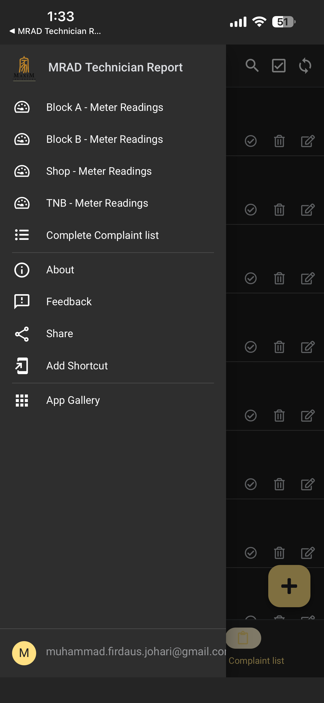
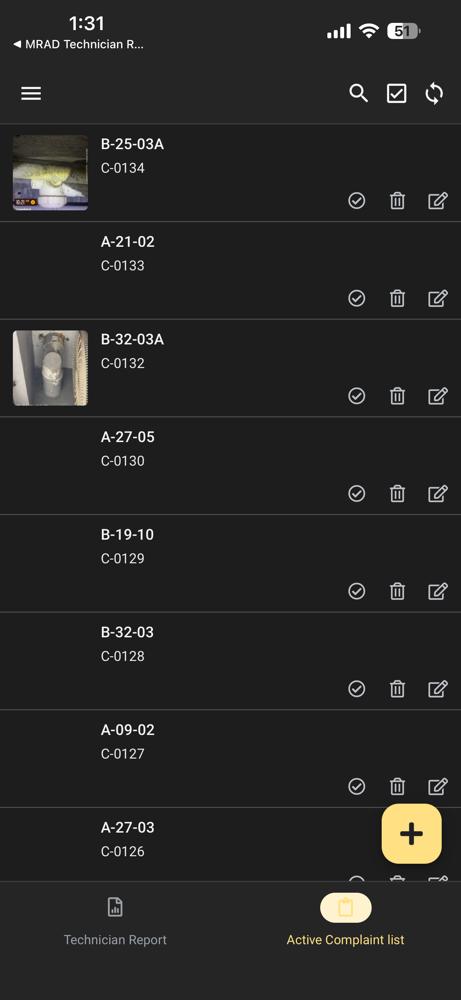
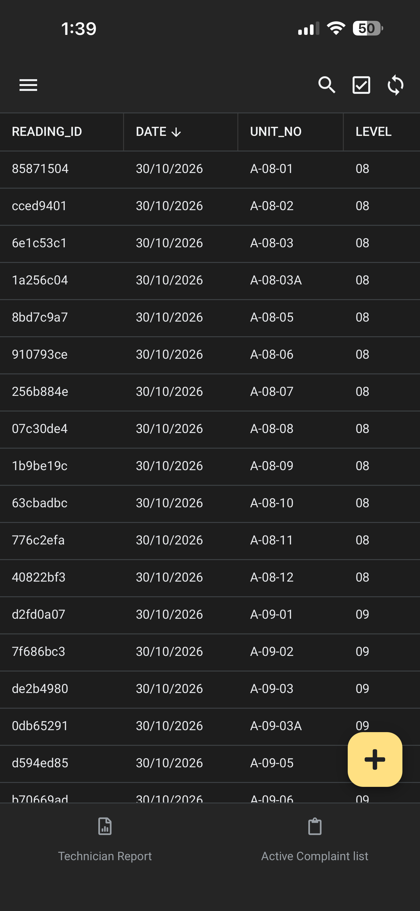
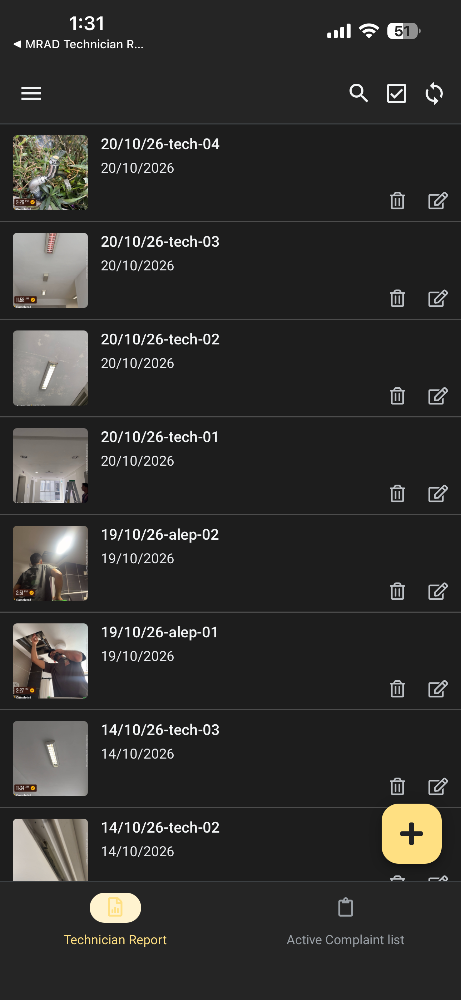

# property-maintenance-dashboard
AppSheet & Looker Studio property maintenance database and dashboard pipeline.

# Property Maintenance Database & Dashboard Pipeline

## Problem Statement
Field water meter readings and residential maintenance logs were recorded manually on paper. This led to data entry errors, delayed reporting, and a lack of real-time visibility into maintenance completion metrics.

## Solution Architecture
1. **Data Collection (AppSheet):** Mobile interface built for field staff to record readings, attaches photos, and auto-validates inputs.
2. **Data Pipeline (Google Sheets / Supabase):** Asynchronous cloud sync to maintain structured database records.
3. **Visualization (Looker Studio):** Interactive dashboard tracking maintenance completion rates, identifying unit bottlenecks, and surfacing usage trends.

## AppSheet Mobile User Interface

| Navigation Menu | Active Complaints List |
| :---: | :---: |
|  |  |

| Water Meter Readings | Technician Reports & Attachments |
| :---: | :---: |
|  |  |

## Cloud Database Layer & Data Pipeline

| Relational Complaint Log | Block Meter Consumption Table |
| :---: | :---: |
|  |  |

## Executive BI Dashboard (Looker Studio)


## AppSheet Meter Reading Formulas & Logic

### 1. Dynamic Unit Numbering (`unit_no`)
```appsheet
CONCATENATE(
  "A-", 
  IF(LEN(TEXT([LEVEL])) = 1, CONCATENATE("0", [LEVEL]), [LEVEL]), 
  "-", 
  IF(LEN(TEXT([UNIT])) = 1, CONCATENATE("0", [UNIT]), [UNIT])
)

### 2. Duplicate Entry Prevention (Data Validity)
```appsheet
NOT(
  IN(
    [UNIT_NO],
    SELECT(
      BlockA_Readings[UNIT_NO],
      AND(
        [UNIT_NO] = [_THISROW].[UNIT_NO],
        YEAR([DATE]) = YEAR([_THISROW].[DATE]),
        MONTH([DATE]) = MONTH([_THISROW].[DATE]),
        [_RowNumber] <> [_THISROW].[_RowNumber]
      )
    )
  )
)

Validation Error Message: ⁠"This unit already has a reading for this month."⁠

### 3. Previous Reading Retrieval (⁠PREVIOUS⁠)
```appsheet
LOOKUP(
  MAXROW(
    "BlockA_Readings", 
    "_ROWNUMBER", 
    AND(
      [UNIT_NO] = [_THISROW].[UNIT_NO],
      [_ROWNUMBER] <> [_THISROW].[_RowNumber]
    )
  ),
  "BlockA_Readings",
  "READING_ID",
  "CURRENT"
)

### 4. Consumption Calculation & Tiered Water Charges
```appsheet
 Usage Formula: ⁠[CURRENT] - [PREVIOUS]⁠
 Tiered Water Charge Formula:
```appsheet
IFS(
  [USAGE] * 3.51 < 10, 10,
  [USAGE] <= 35, [USAGE] * 3.51,
  [USAGE] > 35, 122.85 + (([USAGE] - 35) * 3.83)
)

### 5. Automated Anomaly Detection (⁠Admin verification⁠)
```appsheet
IF(
  OR([USAGE] > 100, [USAGE] < 0),
  "Flagged: Unusual Consumption!",
  "Normal"
)
